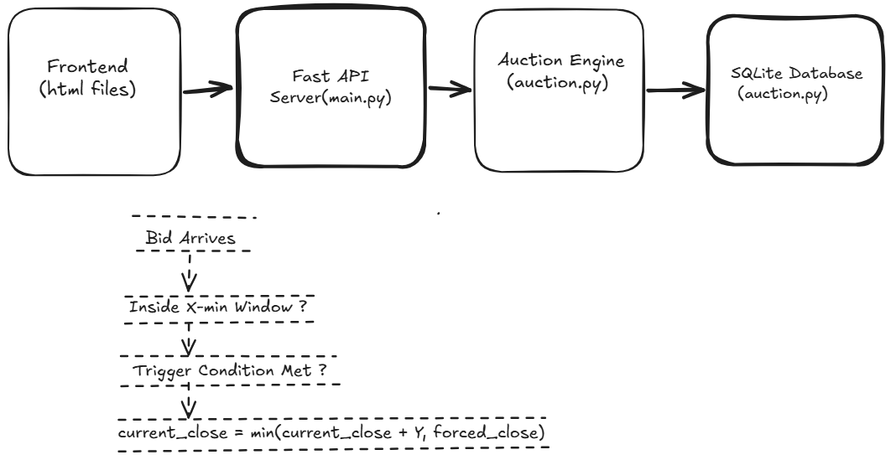

# British Auction RFQ System

This is a simple web application built for managing freight RFQs using British Auction rules. Carriers can submit quotes, see live rankings (`L1`, `L2`, `L3`), and the auction closing time automatically extends when qualifying bids arrive near the deadline.

## Tech Stack
- **Backend:** Python, FastAPI, SQLAlchemy
- **Database:** SQLite
- **Frontend:** HTML, CSS, JavaScript (`fetch` API)

## High-Level Architecture


### How the Extension Logic Works
1. When a carrier submits a quote, the backend checks if the auction is active (`bid_start <= now < current_close`).
2. It calculates the supplier rankings before and after adding the new bid (grouping by carrier so each carrier's lowest quote is ranked).
3. If the bid arrives inside the last `X` minutes (`trigger_window_minutes`), it checks the RFQ's trigger rule:
   - `BID_RECEIVED`: extends on any valid bid in the window.
   - `ANY_RANK_CHANGE`: extends only if the order of carriers changes.
   - `L1_CHANGE`: extends only if the lowest (`L1`) carrier changes.
4. If triggered, `current_close` increases by `Y` minutes (`extension_minutes`), capped so it never goes past `forced_close`.

## Database Tables
1. **`rfqs`**: Stores RFQ details, start/close/forced-close timestamps, trigger window (`X`), extension duration (`Y`), and trigger rule.
2. **`bids`**: Stores carrier quotes (`freight_charges`, `origin_charges`, `destination_charges`, `total`, `transit_time`, `quote_validity`) linked to an RFQ.
3. **`activity_logs`**: Keeps a timestamped history of every submitted bid and every closing time extension.

## Steps to Run Locally

1. **Install required packages:**
   ```bash
   pip install fastapi uvicorn sqlalchemy
   ```

2. **Start the FastAPI server:**
   ```bash
   python -m uvicorn main:app --reload
   ```

3. **Open the application:**
   - Open `http://127.0.0.1:8000` in your browser to create RFQs and place bids.
   - Open `http://127.0.0` to view the FastAPI Swagger endpoints.